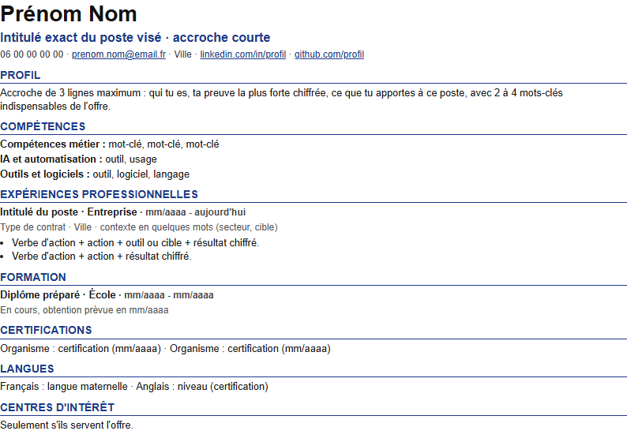
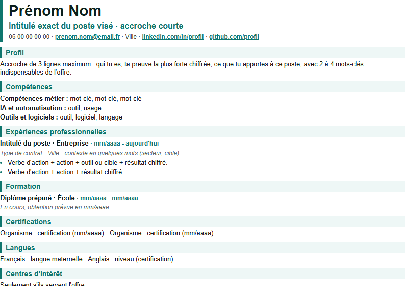
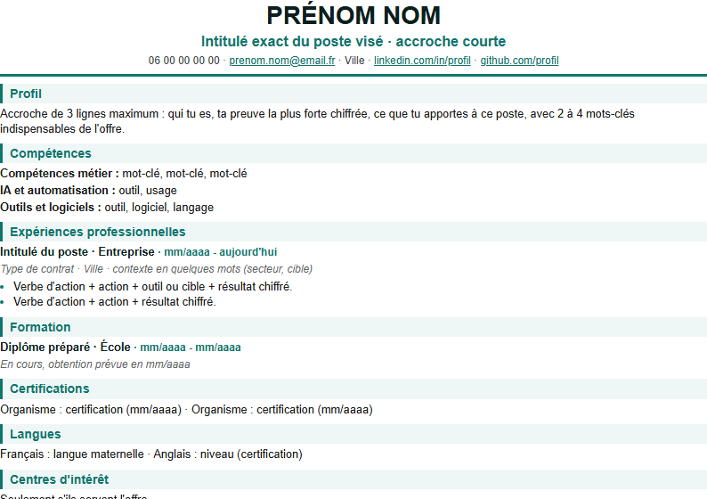
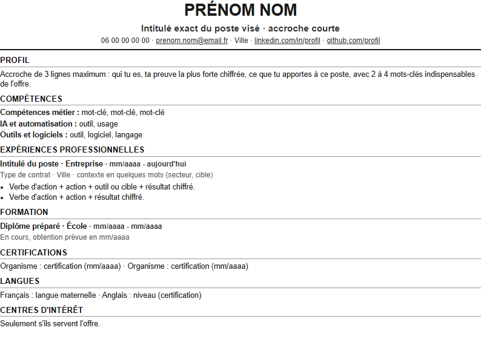
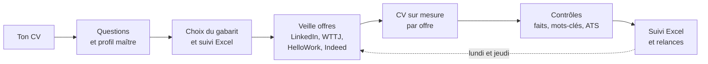

# cv-ats-fr

**Ton assistant de recherche d'emploi dans Claude Code : il trouve les offres, écrit un CV sur mesure pour chacune, et suit tes candidatures. Sans jamais rien inventer.**

Un CV générique envoyé à 50 offres ne passe pas les ATS, ces logiciels qui trient les candidatures par mots-clés avant qu'un recruteur ne les lise. Adapter son CV à chaque offre marche, mais ça prend une heure par candidature.

cv-ats-fr fait ce travail pour toi. Tu lui donnes ton CV une fois. Ensuite, deux fois par semaine, il cherche les offres sur **LinkedIn, Welcome to the Jungle, HelloWork et Indeed**, garde celles qui te correspondent, prépare un CV optimisé pour chacune et met à jour ton tableau de suivi Excel. Toi, tu relis et tu postules.

Il marche pour **tous les métiers** (vente, tech, marketing, finance, RH, support, santé, industrie…), en CDI, CDD, stage ou alternance, en français ou en anglais.

| Classique | Moderne | Moderne centré | Sobre |
|-----------|---------|----------------|-------|
|  |  |  |  |

---

## Ce qu'il fait pour toi

### 1. Il apprend à te connaître, une seule fois
Au premier lancement, il lit ton CV (PDF, Word, texte ou profil LinkedIn) et te pose des questions courtes : le poste que tu vises, le contrat, la ville, le télétravail, tes résultats chiffrés, ce que tu veux mettre en avant. Il en tire ton **profil maître**, la base de tous tes futurs CV. Tu le valides avant qu'il serve.

### 2. Il cherche les offres sur LinkedIn, Welcome to the Jungle, HelloWork et Indeed
Il lit les offres publiques de ces quatre sites, plus APEC, France Travail et les pages carrières des entreprises qui t'intéressent. Pour chaque offre, il te donne :
- l'**affinité** avec ton profil (Excellente, Bonne, Moyenne, Faible), calculée sur les exigences réelles de l'annonce ;
- le **salaire et les avantages** quand ils sont écrits (télétravail, BSPCE, tickets restaurant…), sans jamais les estimer ;
- la **santé de l'entreprise**, avec une source (chiffre d'affaires, croissance, levée de fonds) ;
- tes **2 meilleurs atouts** pour ce poste et ton **principal écart**.

Il ne garde que les offres qui valent ton temps, et te fait un rapport avec le top 3.

### 3. Il écrit un CV sur mesure pour chaque offre
- Il extrait de l'annonce les 12 à 20 **mots-clés** que l'ATS va chercher, sous leur forme exacte.
- Il mesure ton CV actuel **avant**, réécrit le CV avec le vocabulaire de l'offre, puis mesure le résultat **après**.
- Il adapte le **titre** à l'intitulé du poste et met tes résultats chiffrés en avant.
- Il fait le CV **en anglais** quand l'annonce est en anglais.
- Il exporte un **PDF d'une page**, avec ton e-mail, ton LinkedIn et ton GitHub en liens cliquables.

### 4. Il ne ment jamais à ta place
C'est sa règle absolue. Tout part de ton profil maître : il peut reformuler, réorganiser, reprendre les mots de l'offre, mais **jamais ajouter un outil, gonfler un chiffre ou embellir un intitulé**. Un script bloquant compare chaque chiffre et chaque intitulé du CV à ton profil. Une compétence que tu n'as pas reste un écart, et il te propose une façon honnête d'en parler en entretien.

### 5. Il vérifie ce que l'ATS lit vraiment
Trois scores séparés, jamais mélangés :
- **Adéquation** : la part des mots-clés indispensables de l'offre présents dans ton CV (objectif : 80 % ou plus).
- **Lisibilité ATS** sur 100 : une colonne, titres standards, e-mail en clair, pas d'image, police standard, pas de texte caché.
- **Qualité** sur 100 : lignes qui commencent par un verbe d'action, résultats chiffrés, accroche courte, pas de clichés.

Il écrit aussi le texte tel que l'ATS le lit, pour vérifier que rien n'est mélangé. Et un « recruteur » virtuel peut relire le CV ligne par ligne, puis dire s'il te convoquerait et pourquoi.

### 6. Il tient ton suivi Excel à jour
Un tableau `suivi.csv` qui s'ouvre directement dans Excel, avec pour chaque candidature : l'entreprise, le poste, l'affinité, le salaire, les avantages, un résumé du poste, les mots-clés à retenir, les scores, et un **lien cliquable vers le CV**. Tu lui dis « X m'a répondu, entretien jeudi », il met à jour.

### 7. Il pense aux relances
Une candidature envoyée depuis 7 jours sans réponse ? Il la marque « à relancer » et te prépare un message de relance de 4 lignes. Il repère aussi les offres fermées, et te montre quels types de postes et d'entreprises répondent le plus.

### 8. Il tourne tout seul
À la fin de l'accueil, il crée **deux tâches planifiées** dans Claude Code, réglées sur tes critères :

| Quand | Ce qui se passe |
|-------|-----------------|
| Lundi et jeudi, 8 h | **Veille offres et suivi** : nouvelles offres, rapport, salaires, relances à faire |
| Lundi et jeudi, 10 h | **CV sur mesure** : un CV complet pour les meilleures offres (6 maximum par passage) |

Tu ouvres ton Excel, tu relis les CV marqués « CV prêt à relire », tu postules.

### 9. Il t'aide aussi après le CV
Sur demande : une **lettre de motivation** courte et adaptée à l'offre, et une **fiche entretien** avec les questions probables, tes meilleures réponses chiffrées et la façon de présenter tes points faibles.

---

## Comment ça marche



## Installation en 3 minutes

1. Copie le dossier `cv-ats-fr` dans `~/.claude/skills/` (Windows : `%USERPROFILE%\.claude\skills\`).
2. Vérifie que tu as **Node.js** (pour les contrôles) et **Microsoft Edge** (pour l'export PDF).
3. Crée un dossier pour tes candidatures, ouvre Claude Code dedans et écris : **« Lance le skill cv-ats-fr. »**

Il s'occupe du reste. L'accueil complet prend une dizaine de minutes :

| # | Étape | Ce qui se passe |
|---|-------|-----------------|
| 1 | Ton CV | Il le lit et prépare ton profil maître. |
| 2 | Ta recherche | Contrat, postes, secteurs, lieu, télétravail, disponibilité, salaire visé si tu veux. |
| 3 | Tes chiffres | Ta semaine type, tes résultats, tes outils, ta plus belle réussite. |
| 4 | Validation | Tu corriges le résumé de ton profil. |
| 5 | Ton modèle de CV | Tu choisis parmi les 4 gabarits. |
| 6 | Ton suivi Excel | Il crée ton tableau, adapté à ton Excel en français ou en anglais. |
| 7 | Première recherche | Il cherche des offres tout de suite et te montre le top 5. |
| 8 | Automatisation | Après ta confirmation, il crée les deux tâches du lundi et du jeudi. |

Ensuite, pour une offre que tu as trouvée toi-même : « Adapte mon CV à cette offre : [lien ou texte]. »

## Exemple de résultat

Test sur un CV fictif de comptable, avec une offre de comptable général :

| Contrôle | Résultat |
|----------|----------|
| Mots-clés indispensables de l'offre | 100 % |
| Lisibilité ATS | 100/100 |
| Qualité du contenu | 92/100 |
| Longueur | 1 page |

## 4 gabarits, tous compatibles ATS

| Gabarit | Style | Pour qui |
|---------|-------|----------|
| [classique](assets/gabarits/classique.html) | Bleu marine, très sobre | Grands groupes, secteur public |
| [moderne](assets/gabarits/moderne.html) | Vert canard, barre de couleur à côté du nom | Tech, start-up |
| [moderne-centre](assets/gabarits/moderne-centre.html) | Vert canard, nom centré, liens soulignés | Polyvalent (par défaut) |
| [sobre](assets/gabarits/sobre.html) | Noir et blanc, nom centré | Conseil, juridique, finance |

Tous en une colonne, avec 100/100 de lisibilité au contrôle du skill. Ils suivent ce que les sources sur les ATS ont en commun en 2026 : une colonne, des titres standards, une police standard, une couleur d'accent mais un CV lisible en noir et blanc, les dates dans la ligne du poste, aucun en-tête ni pied de page, aucune icône.

## Ce qu'il ne fera jamais

- **Postuler à ta place**, envoyer un e-mail ou un message, remplir un formulaire. Les relances sont préparées, jamais envoyées.
- **Se connecter à tes comptes.** Il lit uniquement les pages publiques des sites d'emploi, sans identifiant, et ne contourne aucun blocage ni CAPTCHA.
- **Inventer** une offre, un lien, un salaire, une compétence ou un chiffre.
- **Publier tes données.** Ton profil, tes CV et ton suivi restent dans ton dossier, sur ton ordinateur. Rien n'est envoyé aux sites d'emploi ni aux recruteurs.

Tu relis chaque CV avant de l'envoyer toi-même.

## Contenu du dossier

```
cv-ats-fr/
├── SKILL.md                      les instructions du skill
├── assets/
│   ├── cv-template.html          le gabarit par défaut
│   └── gabarits/                 les 4 gabarits et leurs aperçus
├── references/
│   ├── accueil.md                le premier lancement, de ton CV jusqu'aux tâches planifiées
│   ├── regles-ats.md             mise en forme, rédaction, design, vocabulaire par métier
│   ├── questions-decouverte.md   les questions pour faire ressortir l'expérience non écrite
│   └── profil-maitre-modele.md   la structure du profil maître
├── scripts/
│   ├── score.mjs                 couverture des mots-clés
│   ├── verif-faits.mjs           contrôle des faits (bloquant)
│   └── verif-ats.mjs             lisibilité ATS, qualité, champs reconnus, texte extrait
└── automatisations/              les modèles des deux tâches planifiées
```

<details>
<summary><strong>Les 10 étapes de chaque CV, en détail</strong></summary>

| # | Étape | Ce qui en sort |
|---|-------|----------------|
| 0 | Accueil au premier lancement | `profil-maitre.md`, `suivi.csv` |
| 1 | Charger le profil maître | questions sur ce qui reste à confirmer |
| 2 | Récupérer l'offre | `offre.md` |
| 3 | Analyser l'offre : intitulé, type de poste, exigences, mots-clés | `analyse.md` |
| 4 | Registre des exigences et des preuves, affinité | tableau exigence / preuve / statut |
| 5 | Score de mots-clés **avant** | `mots-cles.json`, score |
| 6 | Rédiger le CV à partir de ton gabarit | `cv.html` |
| 7 | Contrôles : faits (bloquant), mots-clés, relecture par un recruteur virtuel | alertes corrigées |
| 8 | Export PDF et contrôle ATS | `CV_Prenom_Nom_Poste.pdf`, `texte-extrait.txt` |
| 9 | Suivi des candidatures | une ligne dans `suivi.csv`, avec un lien cliquable vers le CV |
| 10 | Compte rendu : 3 scores, écarts, passerelles honnêtes | résumé |

</details>

## Limites

- Pensé d'abord pour le marché français (alternance, usages de CV). L'anglais est géré par traduction fidèle de ton profil.
- Les scores mesurent la structure et les mots-clés, pas la décision d'un recruteur. Ce sont des indicateurs, pas la note d'un vrai ATS.
- Certains sites bloquent la lecture automatique de leurs pages, LinkedIn surtout. Dans ce cas, il passe au site suivant ou cherche la même offre ailleurs, et te le signale.
- Les tâches planifiées tournent quand l'app Claude est ouverte ; sinon, elles démarrent au prochain lancement.
- L'export PDF est prévu pour Windows avec Edge. Sur Mac ou Linux, adapte la commande d'export de `SKILL.md` (Chrome ou Chromium en mode headless).
